# รายงานผล Lab 9

## Checkpoint 1.1

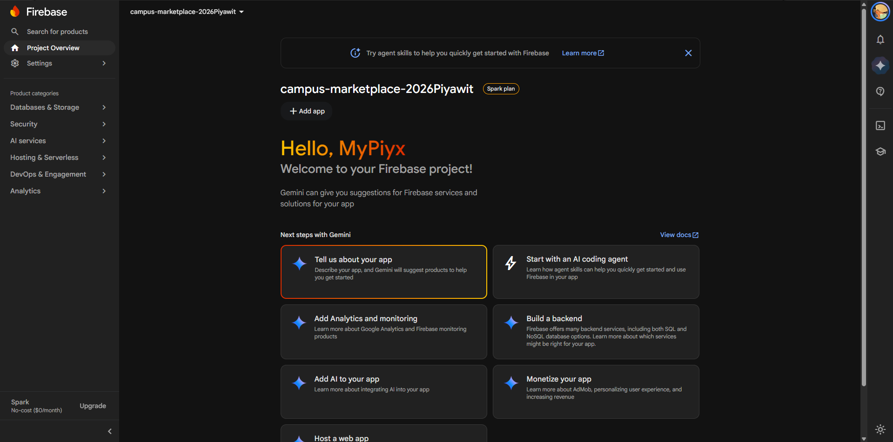

## Checkpoint 2.1

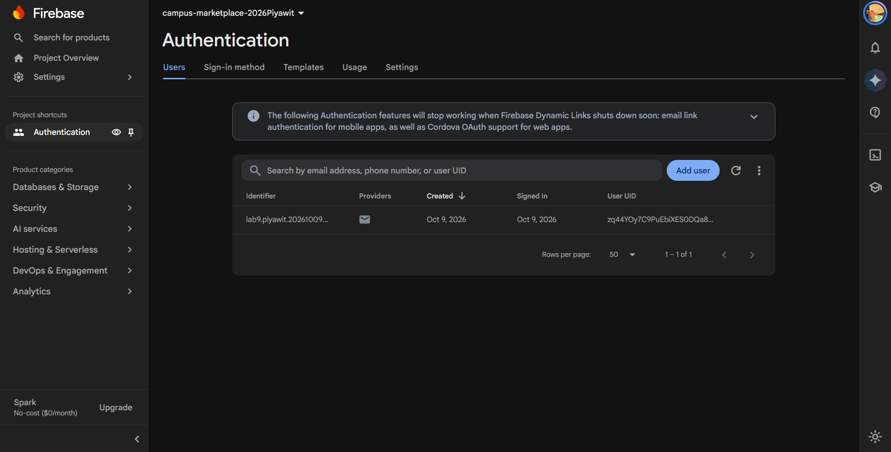
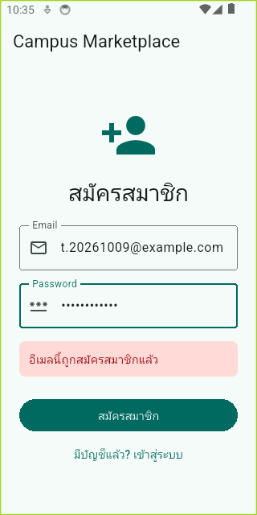
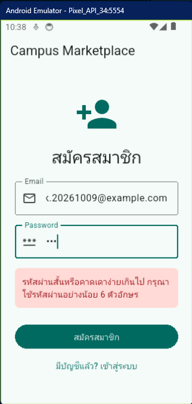

กรณีสมัครซ้ำ Firebase ส่ง `email-already-in-use` และ `AuthService._message()` แปลงเป็น “อีเมลนี้ถูกสมัครสมาชิกแล้ว” ส่วนรหัสผ่านสั้นส่ง `weak-password` และแปลงเป็น “กรุณาใช้รหัสผ่านอย่างน้อย 6 ตัวอักษร” จึงไม่มี error ดิบหลุดสู่ UI

## Checkpoint 3.1

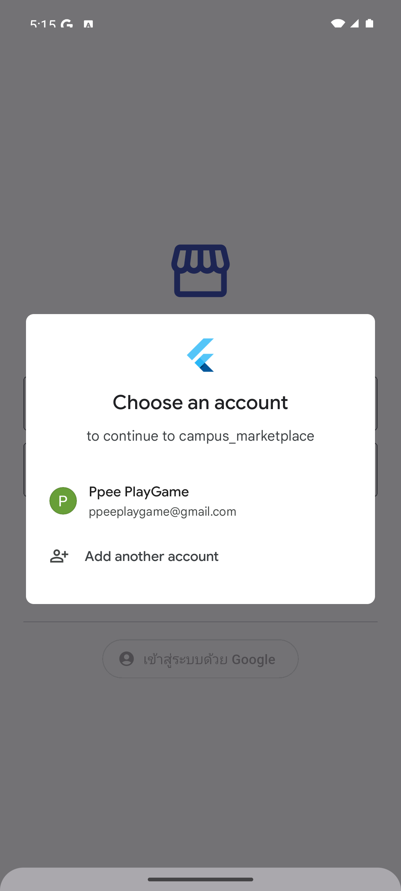
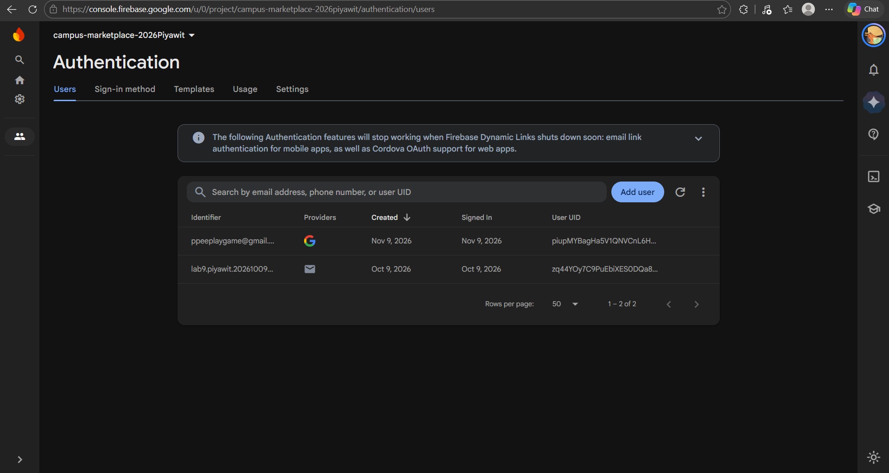

`idToken` เป็นหลักฐานยืนยันตัวตนที่ Google ออกให้ ส่วน `accessToken` ใช้อนุญาตเข้าถึง scope ที่ผู้ใช้ยินยอม แอปนำทั้งคู่สร้าง `GoogleAuthProvider.credential()` แล้วส่งให้ `FirebaseAuth.signInWithCredential()` เพื่อให้ Firebase ตรวจสอบและสร้าง session ของผู้ใช้

## Checkpoint 4.1

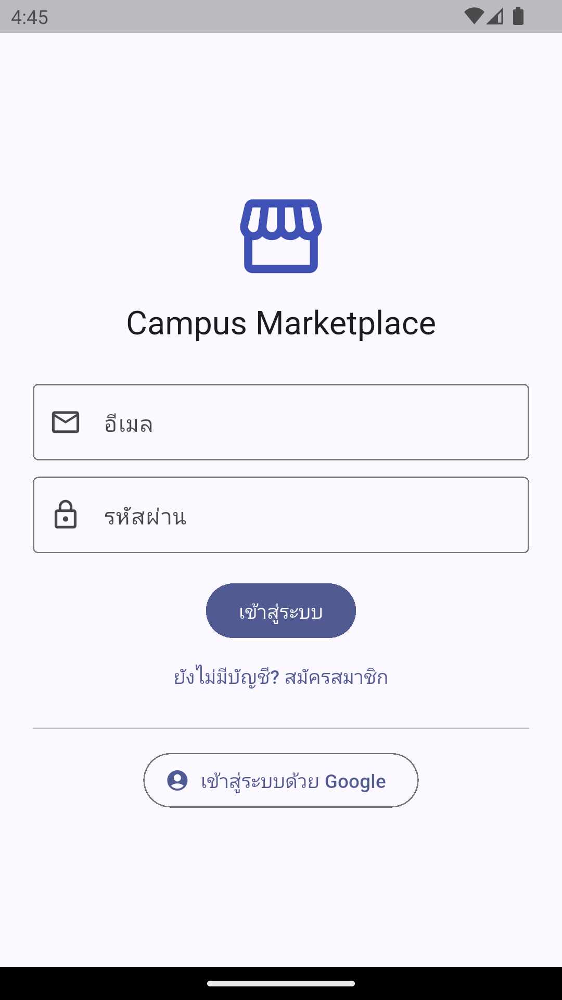
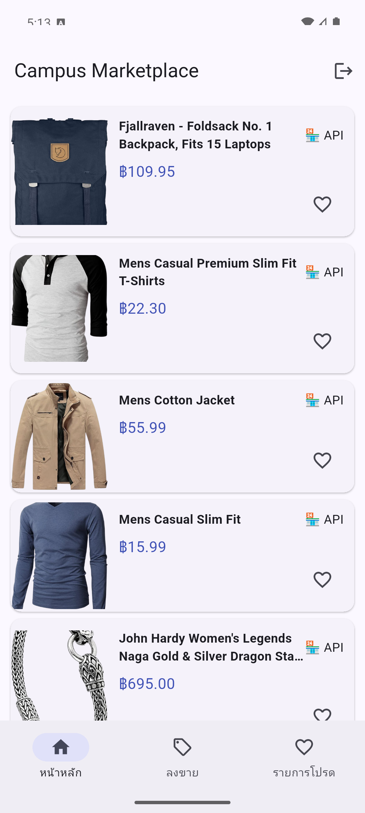
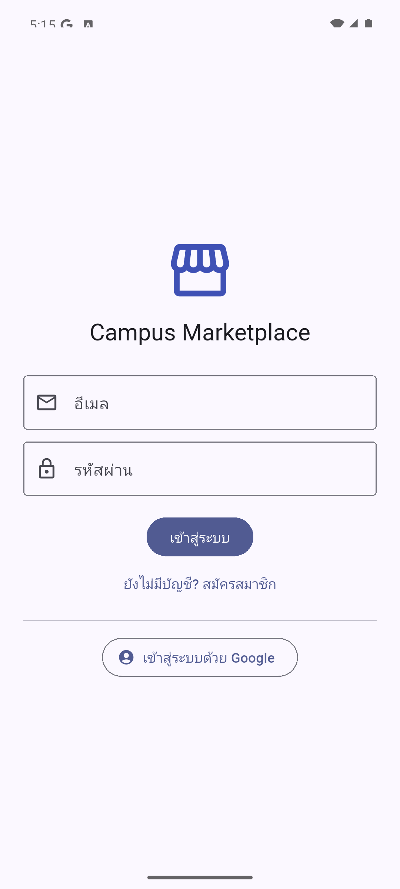

`AuthGate` ฟัง `authStateChanges()` ผ่าน `StreamBuilder` เมื่อ Firebase เปลี่ยนสถานะ user stream จะ rebuild และเลือก `LoginPage` หรือ `MainScaffold` เอง จึงไม่ต้อง push/pop route ด้วยมือและรองรับสถานะ login ที่จำไว้หลังเปิดแอปใหม่

## คำตอบส่วนที่ 5.1

1. การเพิ่ม `ItemRepositoryFirestore` รักษา interface เดิมและแยกหน้าที่ของแหล่งข้อมูลแต่ละชนิด `HomePage` จึงไม่ผูกกับ Firebase SDK ทดสอบด้วย fake repository ได้ และเพิ่ม/ถอดแหล่งข้อมูลได้โดยไม่แก้ UI
2. หากเปลี่ยน Fake Store API เป็น API ใหม่ ให้สร้างหรือแก้ implementation ของ repository เพียงไฟล์เดียว แล้วเปลี่ยนจุดประกอบ dependency ใน `main.dart` หนึ่งจุด Widgets ที่เรียก `ItemRepository` ไม่ต้องแก้

## Checkpoint 5.1

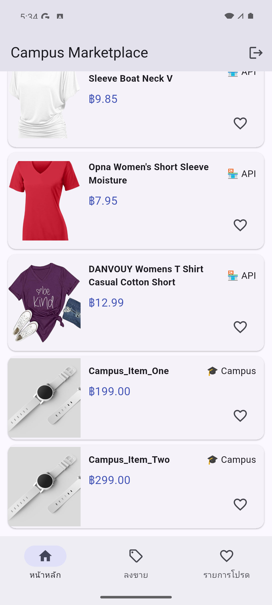

การพึ่ง abstraction `ItemRepository` ทำให้ UI รับเพียง `List<Item>` ไม่รู้รายละเอียด HTTP หรือ Firestore จึงสลับแหล่งข้อมูล เขียน mock และทดสอบแยกส่วนได้ง่าย

## Checkpoint 6.1–6.2

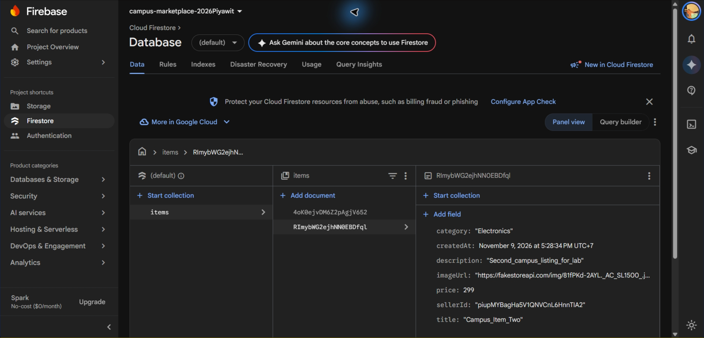

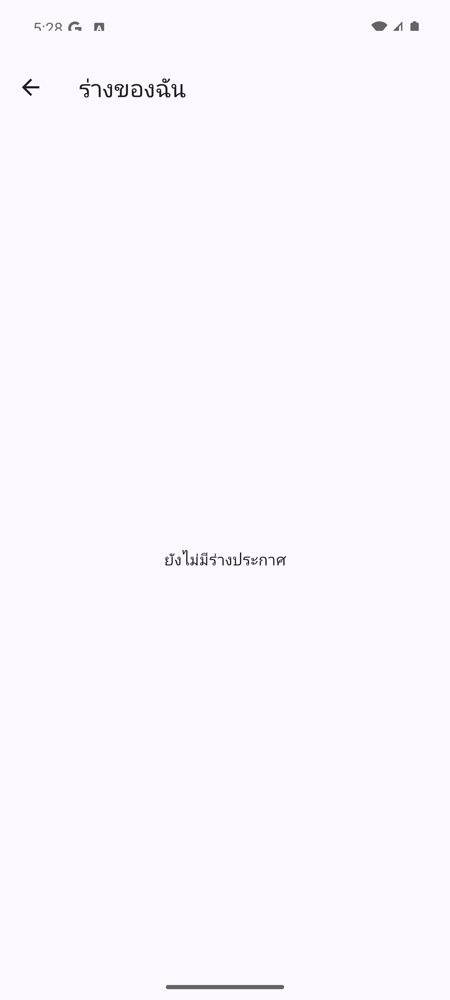
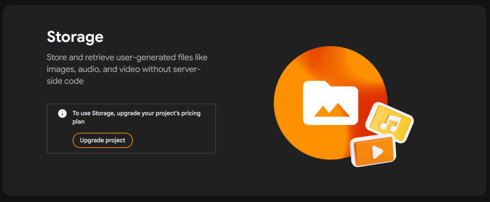

ลำดับโพสต์คือถามราคา → อัปโหลดรูปและรอ Download URL → สร้าง `Item` พร้อม `sellerId` → เขียน Firestore → ลบร่างใน Drift การรอแต่ละขั้นทำให้เอกสารไม่มี URL ที่ยังใช้งานไม่ได้ และร่างไม่หายหาก upload/post ล้มเหลว

## Checkpoint 7.1

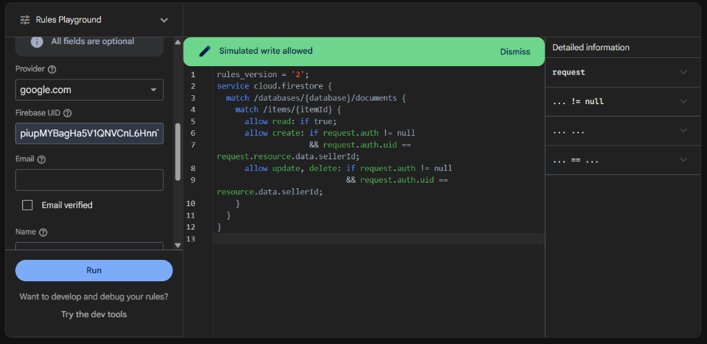
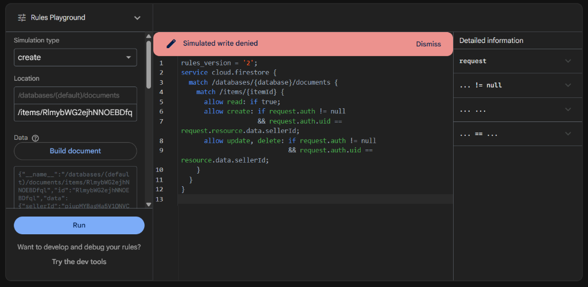

Client-side validation หรือการซ่อนปุ่มไม่ใช่มาตรการความปลอดภัย เพราะผู้โจมตีแก้ client หรือเรียก Firebase API โดยตรงได้ Security Rules ทำงานบน server และตรวจ `request.auth.uid` กับ `sellerId` ทุกคำขอ จึงเป็นด่านที่บังคับใช้จริง

## Checkpoint 8.1

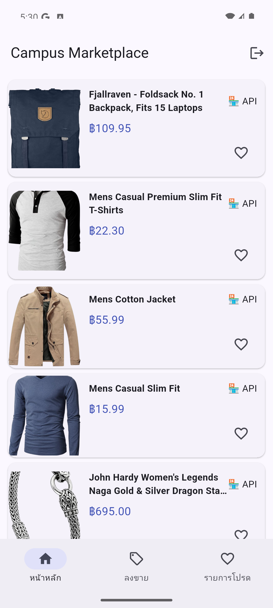
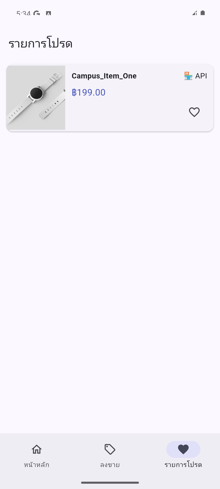
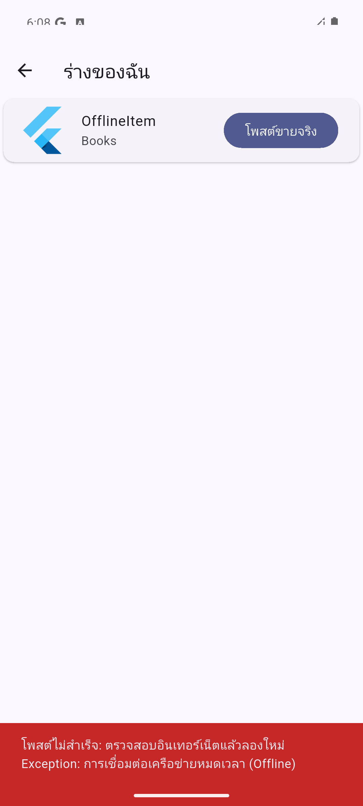
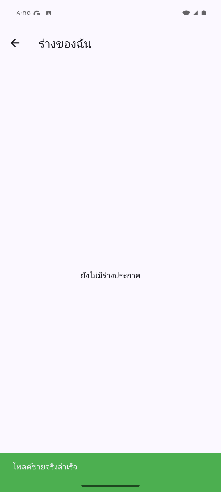

Firebase Auth เก็บ session ไว้ในเครื่องจึงไม่ต้อง login ใหม่เมื่อเปิดแอป ส่วน Favorites และ Drafts อ่านจาก SQLite ผ่าน Drift จึงใช้ได้โดยไม่มีเครือข่าย การโพสต์จริงต้องส่งไฟล์ไป Storage และเอกสารไป Firestore จึงล้มเหลวเมื่อ offline; แอปจับ error แสดงข้อความและเก็บร่างไว้ให้ลองใหม่หลังออนไลน์
